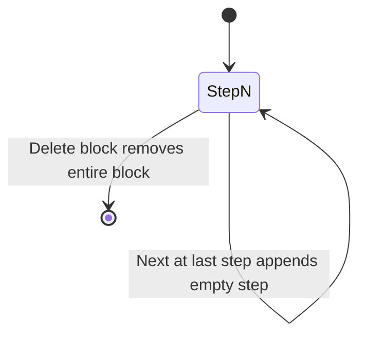

# Step to N — bloque de instrucciones por pasos

## Objetivo

Nueva estructura **Step to N** para que usuarios peguen/guarden sets de instrucciones (migración desde otras plataformas). Flujo elegido: **siempre wizard** — un chunk de texto visible a la vez, navegación **Back / Next**, pasos ilimitados, **eliminar bloque completo**.

El snippet 21st (email/password/2FA) se adapta como **patrón de UI** (AnimatePresence + un panel por paso), no como formulario fijo de 3 pasos.

## Modelo de datos

Nuevo tipo en [`src/lib/docBlocks.js`](src/lib/docBlocks.js):

```js
DOC_BLOCK_TYPES.STEP_SEQUENCE = "step_sequence"

// Bloque persistido
{
  id: "BLK-…",
  type: "step_sequence",
  steps: [
    { id: "STEP-…", text: "…" },
    // …
  ],
}
```

- Helper `createStepEntry(text)` con `generateId("STEP")`.
- `createDocBlock` / `normalizeDocBlock`: normalizar `steps[]`, mínimo 1 paso vacío al crear.
- Serialización body (backup/search): `::stepsequence\n${JSON.stringify({ steps })}` en `docBlocksToBody` / `parseStepSequenceSection` en `docBlocksFromBody` — mismo patrón que `password_vault` / `link_vault`.

## UX (wizard permanente)



Comportamiento en [`StepSequenceBlockView.jsx`](src/components/docs/blocks/StepSequenceBlockView.jsx) (nuevo):

| Control | Acción |
|--------|--------|
| Textarea | Edita `steps[activeIndex].text` |
| **Next** | Persiste texto actual; si es el último paso, añade paso vacío; `activeIndex++` |
| **Back** | `activeIndex--` (deshabilitado en paso 0) |
| **Eliminar bloque** | `onDeleteBlock()` → `removeBlockAt` en stack padre |
| Header | `Step {n} of {total}` (o "Step to N" + contador) |

- Transiciones con **framer-motion** (`AnimatePresence`, ya en el proyecto) — equivalente al snippet, sin `@/components/ui/*`.
- Auto-grow textarea reutilizando [`syncAutoGrowTextareaHeight`](src/lib/textareaSelectionRect.js) (como Agent/Code).
- **Auto-save**: cada cambio de `steps` propaga vía `onStepsChange` → `updateBlockAt` (mismo patrón que Password vault).

## Integración en documentos

Archivos a tocar (patrón idéntico a `password_vault` / `agent`):

1. [`src/lib/docBlocks.js`](src/lib/docBlocks.js) — tipo, factory, normalize, serialize/parse.
2. [`src/lib/docBlockSlash.js`](src/lib/docBlockSlash.js) — comando slash:
   - Label: **Step to N**
   - Aliases: `stepton`, `step2n`, `step-to-n`, `steps`, `instrucciones`
   - `blockType: step_sequence`, `nodeDataType: text`
3. [`src/components/docs/blocks/DocBlockStack.jsx`](src/components/docs/blocks/DocBlockStack.jsx) — rama render + `onDeleteBlock`; **no** tratarlo como singleton vault (puede haber varios bloques Step to N en un doc).
4. [`src/components/docs/blocks/StepSequenceBlockView.jsx`](src/components/docs/blocks/StepSequenceBlockView.jsx) — componente wizard.
5. CSS en [`src/styles/left-panel.css`](src/styles/left-panel.css) — clases `doc-step-sequence-*` alineadas a `doc-agent-cell` / `doc-vault-block` (header, card, botones, contador).

**No** enlazar a canvas/timeline (`docNodeSync` opcional omitido — es almacén de instrucciones, no macro-node).

## Integración en nodos

Para cumplir "documentos **y** nodos":

1. [`src/lib/nodeInlineContent.js`](src/lib/nodeInlineContent.js) — `NODE_BLOCK_TYPES.STEP_SEQUENCE`, `createInlineStepSequenceBlock()`, normalize + serialize en `node-body`.
2. [`src/lib/docBlockSlash.js`](src/lib/docBlockSlash.js) — incluir en `NODE_SLASH_COMMANDS` (junto a code, password, agent).
3. [`src/components/nodes/NodeWritingBlockStack.jsx`](src/components/nodes/NodeWritingBlockStack.jsx) — importar y renderizar `StepSequenceBlockView` con `compact` si aplica.

Los nodos de texto (`node-body`) podrán insertar `/stepton` igual que en docs.

## Persistencia

Sin cambios de schema Supabase: el bloque vive en `campaigns.blocks` JSON (ya soportado por [`persistenceMiddleware.js`](src/stores/middleware/persistenceMiddleware.js) y [`docsStore.js`](src/stores/docsStore.js)).

Actualizar JSDoc en [`src/types/docs.js`](src/types/docs.js) con el nuevo tipo.

## Fuera de alcance (v1)

- Eliminar un paso individual (solo bloque completo; se puede añadir después).
- Traducción i18n completa (labels ES/EN inline como Agent/Password).
- Enlace a agentes/orquestador (instrucciones son storage manual del usuario).

## Verificación manual

1. Doc: `/stepton` → wizard paso 1 → pegar texto → Next → paso 2 → Back → editar → recargar doc → pasos persisten.
2. Nodo standalone: mismo slash en modal de nodo → mismos pasos.
3. Eliminar bloque (×) → desaparece del doc y del save.
4. Body legacy: doc sin `blocks` pero con `::stepsequence` en body → parse correcto al abrir.
