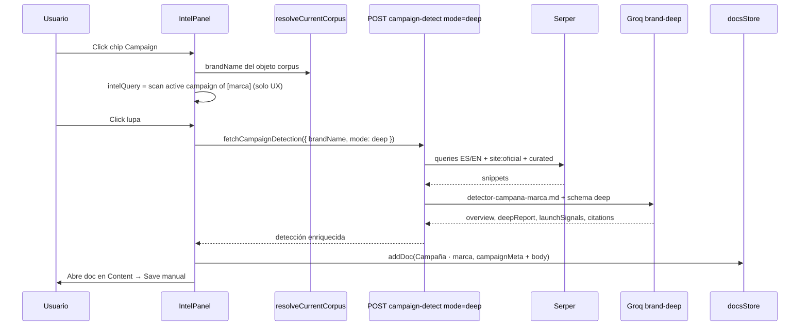

# Blueprint: Scan Campaign (Intel) → estudio profundo de una marca → documento Content

> **Estado:** especificación aprobada para implementación.  
> **Recomendación adoptada:** **Opción B** (reusar `campaign-detect`, no `runIntelSearch`) + **modo deep** (prompt, queries y citations propios de una sola marca).  
> **Fecha:** 2025-06-25

---

## Viabilidad

**Sí, es viable.** La mayor parte del pipeline ya existe; el trabajo nuevo es acotar el scan a **una marca del corpus**, enriquecer búsqueda + salida Groq, y conectar el chip **Campaign** de Intel con creación de doc Content.

| Pieza | Estado en repo |
|--------|----------------|
| Detectar campaña de una marca | `POST /api/analytics/campaign-detect` → `detectBrandIntel()` |
| Mapear resultado → fields editables | `campaignSignalFieldsFromDetection()` |
| UI doc: Campaign / Launch / Today / Window | `DocMetaStrip.jsx` + `formatWindowDays()` |
| Crear doc en Content | `docsStore.addDoc(..., campaignMeta)` |
| Marca del header / corpus | `resolveCurrentCorpus()` → `object.brand` |
| Citations tipo Intel | `server/intelOverviewPipeline.js` (`citationsFromSnippets`) |
| **No existe** | Chip Campaign en Intel → scan + doc; prompt deep; queries ES/EN; `deepReport` + `citations[]` en API |

**Problema actual:** `detector-de-campanas.md` (Horizon / detonadores de demanda) se inyecta también en modo `brand`. Eso produce un overview genérico binario (¿campaña sí/no?) con **una sola** `evidenceUrl`, no un informe profundo de la marca seleccionada.

---

## Architectural design

### Flujo producto (Opción B — recomendada)



### Por qué Opción B (y no Intel overview)

| | Opción A (mezclar Intel search) | **Opción B (recomendada)** |
|--|--------------------------------|----------------------------|
| API | `/api/intel/overview` | `/api/analytics/campaign-detect?mode=deep` |
| Prompt | Overview genérico + citations | Prompt **solo marca** + fields de campaña |
| Coste | Tokens Intel + otro schema | Un pipeline alineado con campaign detect |
| Doc meta | Habría que mapear a mano | `campaignSignalFieldsFromDetection()` ya listo |
| Riesgo | Mezclar feeds estáticos y live scan | Separación clara News vs Campaign |

**Reglas de producto (Opción B):**

1. Chip **Campaign** → autocompletar query visual; **fuente de verdad = `resolveCurrentCorpus().brandName`**, no el textarea libre.
2. Lupa con `tab === "campaign"` → **`fetchCampaignDetection`**, nunca `runIntelSearch`.
3. Respuesta → **`addDoc("Campaña · {marca}", …, campaignMeta)`** + body (`overview` + `deepReport` + bloque Sources).
4. **`onOpenDocument(newDocId)`** — el usuario revisa y pulsa **Save** (sin auto-save).
5. **Gate de plan:** reutilizar gates de campaign live / tokens antes del API call (detect deep es más barato que `campaignStudyPipeline` completo).

**Qué NO hacer:**

- Pasar markdown del detector al cliente para “inyectarlo” en Groq (duplicado e inseguro).
- Reutilizar `detector-de-campanas.md` en el scan de usuario (solo Horizon Scan admin).
- Auto-save silencioso sin que el usuario vea el doc.

### Extensión “deep brand” (requisito del usuario)

Separar **dos capas de inteligencia**:

| Capa | Campo | Propósito |
|------|-------|-----------|
| Resumen ejecutivo | `overview` | 2–3 frases en español (como hoy) → meta strip |
| Estudio profundo | `deepReport` | Párrafos: qué se anunció, fechas citadas, novedad vs ciclo anterior |
| Señales de lanzamiento | `launchSignals[]` | Frases con patrones ES/EN + `dateHint`, `url`, `quote` |
| Fuentes verificadas | `citations[]` | Hasta 6–10 URLs de Serper (mismo patrón que Intel) |

**Schema JSON objetivo (Groq, modo deep):**

```json
{
  "overview": "2-3 frases en español, solo facts de snippets",
  "deepReport": "Informe en párrafos: producto/evento, fechas, comparación con último launch si aplica",
  "campaignActive": true,
  "launchDate": "YYYY-MM-DD|null",
  "announcementDate": "YYYY-MM-DD|null",
  "detectionMode": "confirmed_campaign|cadence_only",
  "launchSignals": [
    {
      "phrase": "acaba de lanzar…",
      "dateHint": "2026-03-15|null",
      "url": "https://…",
      "quote": "cita ≤200 chars del snippet"
    }
  ],
  "citations": [
    {
      "title": "…",
      "url": "https://…",
      "snippet": "…",
      "sourceType": "official|news|blog"
    }
  ]
}
```

Reglas Groq:

- Solo hechos presentes en snippets Serper.
- `citations` = URLs que pasaron Serper; validar con lógica similar a `citationsFromSnippets` / `citationsFromLlm`.
- `launchSignals` = snippets donde aparezcan patrones configurables (lista ES/EN abajo).
- Mantener clasificación `confirmed_campaign` vs `cadence_only` para `campaignActive` y fechas.

### Prompt de negocio — documento nuevo

**Crear:** `content/admin/detector-campana-marca.md`  
**No tocar para user scan:** `content/admin/detector-de-campanas.md` (Horizon Scan admin).

Contenido mínimo del doc nuevo:

- Analizar **únicamente** `{marca}` del corpus activo; ignorar otras marcas en snippets.
- Objetivo: **informe de campaña/lanzamiento**, no “objetos padre” ni Matriz 1/2.
- Prioridad: fechas (anuncio, launch, shipping, pre-order), producto/evento nuevo, cambio vs lanzamiento anterior.
- Cada afirmación debe poder citarse con URL + cita corta del snippet.

**Wire en servidor:** `scanIntelContext.js` → nuevo mode `"brand-deep"` que carga `detector-campana-marca.md` (con `{brandName}` sustituido), **sin** `loadDetectorContext()` de Horizon.

### Capa de búsqueda Serper

**Nuevo archivo:** `server/discovery/brandDeepCampaignQueries.js` → `buildBrandDeepCampaignQueries(brandName, year, officialDomain?)`

**Español:**

- `"${marca}" "acaba de lanzar" OR "acaba de anunciar" ${year}`
- `"${marca}" "este lanzamiento" OR "nuevo lanzamiento" ${year}`
- `"${marca}" "disponible desde" OR "preventa" OR "fecha de lanzamiento" ${year}`

**Inglés:**

- `"${marca}" "just launched" OR "now available" OR "shipping starts" ${year}`
- `"${marca}" "launch date" OR "pre-order" ${year}`

**Oficial (si hay dominio en corpus u objeto):**

- `site:${domain} (launch OR lanzamiento OR "new") ${year}`

**Fuentes curadas (admin Scan Sources):**

- Reusar `buildCuratedSourceQueries` scoped: `"${marca}" + site:…`

Mantener queries actuales de `brandLaunchQueries.js` para Pass A admin; el modo deep usa el set ampliado.

### Mapeo doc Content

| Campo UI (`DocMetaStrip`) | Origen API |
|---------------------------|------------|
| Campaign active/inactive | `campaignActive` |
| Launch | `launchDate` → `launchAt` |
| Today | `getToday()` automático |
| Window | `formatWindowDays(today, launchIso)` |
| Body — H1 + overview | `overview` |
| Body — informe | `deepReport` (bloques TEXT) |
| Body — Sources | `citations[]` (lista clicable, patrón `IntelSourcesList`) |

Título recomendado: **`Campaña · {marca}`**.

`campaignMeta` vía `campaignSignalFieldsFromDetection()` + campos extra si hace falta persistir `citations` en doc (evaluar en STEP 2 si van en blocks o en `dataProperties`).

### Comparación detector actual vs propuesta

| | Detector actual (`brand`) | Propuesta `brand-deep` |
|--|---------------------------|------------------------|
| Prompt | Horizon + detonadores | `detector-campana-marca.md` |
| Queries | 3 EN genéricas | EN + ES + oficial + curated |
| Salida | overview + 1 `evidenceUrl` | overview + deepReport + citations[] |
| Uso | ¿Hay campaña? | **Qué campaña, cuándo, fuentes** |

---

## Affected files

```
content/admin/
  detector-campana-marca.md          CREATE — prompt solo una marca

server/
  scanIntelContext.js               MODIFY — mode "brand-deep", load nuevo md
  campaignIntelSchema.js            MODIFY — SYSTEM_PROMPT_BRAND_DEEP + builders
  brandCampaignIntel.js             MODIFY — detectBrandIntelDeep() o flag mode=deep
  campaignDetectorHandler.js        MODIFY — query/body mode=deep
  discovery/
    brandDeepCampaignQueries.js     CREATE — queries ES/EN/oficial

src/
  lib/
    fetchCampaignDetection.js       MODIFY — param mode: "deep"
    intelCampaignScan.js            CREATE — runCampaignScanForCorpus()
    campaignDocFromDetection.js     CREATE — map API → addDoc payload + blocks
    currentCorpus.js                OK
    campaignSignalFields.js         MODIFY — opcional citations/deepReport helpers
  panels.jsx                        MODIFY — tab campaign: inject query, branch lupa
  components/left/LeftPanel.jsx     MODIFY — callback abrir doc creado (si no existe)
  i18n/messages.js                  MODIFY — hints sin marca, scanning, error
  api/routes.js                     VERIFY — campaignDetect route unchanged path

memoria.md                          MODIFY — registrar feature al cerrar
.cursor/skills/brand-campaign-deep-scan/
  SKILL.md                          CREATE — skill de implementación (opcional, ver skill hermano)
```

---

## Edge cases

1. **Sin objeto corpus o `brand` vacío** → no llamar API; hint: “Definí la marca en el objeto corpus”.
2. **`cadence_only` / sin campaña activa** → crear doc igual con `campaignActive: false`, `estimatedLaunchDate` si aplica, overview + deepReport de cadencia.
3. **Usuario edita textarea** → ignorar texto libre; escanear siempre `resolveCurrentCorpus().brandName`.
4. **Free sin tokens / límite campaign** → modal upgrade antes del fetch.
5. **Content vacío** → `addDoc` crea el primer doc y lo abre; no requiere docs previos.
6. **Serper sin hits** → respuesta `noData` clara; no inventar informe.
7. **Snippet menciona otra marca** → prompt deep debe descartar claims no atribuibles a `{marca}`.

---

## Decisiones de producto

| Decisión | Valor |
|----------|--------|
| Contador ciudad Forecast | No (feature separado) |
| Scan campaign cuesta tokens | Sí; alinear con campaign live o tier más barato que study completo |
| Título doc | `Campaña · {marca}` |
| Auto-save | No — Save manual |
| Overview en UI Intel | Opcional preview; doc es source of truth |
| Admin Horizon | Sigue usando `detector-de-campanas.md` |

---

## STEP 2: protocolo de ejecución granular

Implementar en este orden (dependencias reales):

### Fase 1 — Backend deep

1. **`content/admin/detector-campana-marca.md`** — redactar prompt analista de una marca (fechas, novedad, citas).
2. **`scanIntelContext.js`** — `loadBrandDeepDetectorContext(brandName)`, mode `"brand-deep"` en `buildGroqUserPrompt`.
3. **`brandDeepCampaignQueries.js`** — queries ES/EN/oficial/curated.
4. **`campaignIntelSchema.js`** — `SYSTEM_PROMPT_BRAND_DEEP`, `buildBrandDeepExtractPrompt()`, validación JSON.
5. **`brandCampaignIntel.js`** — rama `mode === "deep"`: Serper multi-query → Groq deep → merge citations con snippets.
6. **`campaignDetectorHandler.js`** — aceptar `mode: "deep"` en body; extender respuesta con `deepReport`, `launchSignals`, `citations`.

### Fase 2 — Cliente Intel + doc

7. **`fetchCampaignDetection.js`** — pasar `mode: "deep"`; ampliar typedef respuesta.
8. **`intelCampaignScan.js`** — `runCampaignScanForCorpus({ objectsById, selectedObjectId })`: validar marca, gate plan, fetch, errores.
9. **`campaignDocFromDetection.js`** — `buildCampaignDocFromDetection(result, brandName)`: `campaignMeta`, `initialBlocks` (overview H1, deepReport, sources).
10. **`panels.jsx`** — al seleccionar tab `campaign`, setear seed query; en lupa, if `tab === "campaign"` → `runCampaignScanForCorpus` + `addDoc` + abrir doc.
11. **`i18n/messages.js`** — strings de error/loading/sin marca.
12. **Smoke test manual** — corpus con marca, chip Campaign, lupa, doc con meta + body + sources, Save.

### Fase 3 — Pulido

13. Mostrar citations en doc o panel lateral reutilizando `IntelSourcesList`.
14. Actualizar `memoria.md` cuando el usuario confirme resolución.

---

## Referencias de código existente

- Corpus / marca: `src/lib/currentCorpus.js`
- Detect API: `server/campaignDetectorHandler.js`, `server/brandCampaignIntel.js`
- Contexto Groq actual: `server/scanIntelContext.js`
- Schema extract: `server/campaignIntelSchema.js`
- Citations Intel: `server/intelOverviewPipeline.js`
- Doc meta campaña: `src/components/docs/DocMetaStrip.jsx`
- addDoc + campaignMeta: `src/stores/docsStore.js`
- Intel panel (tab + lupa hoy): `src/panels.jsx` (~L821–L864)

---

## Confirmación

Este blueprint adopta **Opción B** como arquitectura de flujo y la **extensión deep brand** como requisito de calidad del informe. La implementación puede proceder en Agent mode siguiendo STEP 2 sin rediseñar el flujo.
