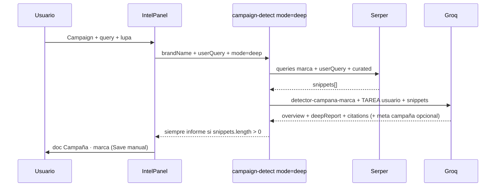

# Blueprint: Campaign scan — informe siempre (report-first)

> **Problema reportado:** el botón Campaign funciona pero no entrega informe.  
> **Causa raíz:** el pipeline prioriza *clasificar campaña* (Horizon-style) sobre *responder la pregunta del usuario*; el texto del textarea no llega a Groq; la validación descarta respuestas útiles.  
> **Fecha:** 2025-06-25

---

## Diagnóstico (por qué hoy no hay informe)

| Capa | Qué pasa hoy | Efecto |
|------|----------------|--------|
| **UI → API** | El campo dice `investigar sobre campañas recientes de {marca}` pero **solo se envía `brandName`** a `/campaign-detect` | Groq no sabe qué pidió el usuario |
| **Serper** | Queries fijas (ES/EN genéricas) | Puede haber snippets, pero no alineados a la intención |
| **Prompt Groq** | `detector-campana-marca.md` + bridge pide `detectionMode: no_data` → **`deepReport: ""`** | Sin campaña “confirmada”, Groq devuelve informe vacío a propósito |
| **Validación** | `normalizeDeepBrandResult` exige `evidenceUrl` en snippets + fechas futuras para `confirmed_campaign` | Rechaza el JSON aunque el LLM escribió un buen informe |
| **Cliente** | Si `error && noData` (ej. falta `SERPAPI_KEY`) → **no crea doc** | Error en panel, cero contenido |
| **Doc** | Solo bloques si hay `overview` / `deepReport` / `citations` | Doc vacío o solo mensaje “Sin evidencia…” |

**Conclusión:** el sistema está bien cableado como *detector binario*; el usuario necesita un *analista que lea instrucciones + web y escriba informe*.

---

## Architectural design (recomendación)

### Principio: **Report-first, classify-second**



### 1. Pasar la intención del usuario al servidor

En `runCampaignScanForCorpus` / `fetchCampaignDetection`:

```json
{
  "brandName": "Nike",
  "mode": "deep",
  "userQuery": "investigar sobre campañas recientes de Nike"
}
```

En `buildBrandDeepExtractPrompt`, añadir bloque explícito:

```text
SOLICITUD DEL USUARIO (responde esto con los snippets):
"{userQuery}"

Marca del corpus: "{brandName}"
```

**Por qué:** Groq debe cumplir la pregunta del textarea, no solo validar si hay launch futuro.

### 2. Serper: buscar lo que pide el usuario

Además de `buildBrandDeepCampaignQueries`:

- Query 1: texto literal del usuario (truncado)
- Query 2: `{brand} recent campaign launch news {year}`
- Query 3–N: ES/EN + curated (existentes)

Opcional: pasar `officialDomain` desde objeto corpus cuando exista campo web.

### 3. Nuevo system prompt — modo `BRAND_RESEARCH` (no clasificador)

Reglas clave para Groq:

```
SI hay ≥1 snippet que mencione la marca:
  - deepReport OBLIGATORIO (mín. 2 párrafos ES)
  - overview OBLIGATORIO (2-3 frases)
  - citations[] desde URLs de snippets (hasta 8)
  - launchSignals[] si hay frases de lanzamiento

campaignActive / launchDate:
  - opcionales; solo si el snippet lo dice claro
  - NO bloquean el informe

detectionMode:
  - "research_report" cuando hay snippets relevantes pero no campaña futura confirmada
  - "confirmed_campaign" | "cadence_only" solo como metadata extra

PROHIBIDO: deepReport vacío cuando hay snippets sobre la marca.
```

Actualizar `detector-campana-marca.md`:

- Sección **OUTPUT ESPERADO** con secciones del informe (Resumen, Lanzamientos recientes, Fechas citadas, Fuentes).
- Quitar la instrucción que vacía `deepReport` en `no_data`.

### 4. Validación relajada — `normalizeDeepBrandReport()`

Nueva función (o rama `mode=deep`):

| Campo | Regla report-first |
|-------|-------------------|
| `deepReport` | Requerido si `snippets.length > 0` y alguno menciona marca (match loose) |
| `overview` | Fallback: primer párrafo de deepReport |
| `evidenceUrl` | Default: URL del snippet más relevante (no rechazar todo el informe) |
| `citations` | `buildCitations(snippets, llm.citations)` — siempre desde Serper |
| Fechas / confidence | No descartan informe; solo alimentan `DocMetaStrip` |

Si Groq falla pero hay snippets: **informe mínimo determinista** (template con títulos + snippets concatenados) — último recurso.

### 5. Cliente: siempre abrir doc con contenido

En `intelCampaignScan.js`:

```javascript
// Crear doc si hay contenido reportable
const hasReport =
  detection.deepReport?.trim() ||
  detection.overview?.trim() ||
  detection.citations?.length;

if (detection.error && detection.noData && !hasReport) {
  return { status: "error", ... };
}
// else → buildCampaignDocFromDetection siempre
```

En `buildCampaignDocFromDetection`:

- Si no hay `deepReport` pero hay `citations`, generar informe desde snippets.
- Bloque **Fuentes** siempre que haya citations.

### 6. Qué NO cambiar

- `detector-de-campanas.md` sigue solo para Horizon Scan admin.
- Tab News + `runIntelSearch` intactos.
- Save manual del doc.

---

## Prompt Groq propuesto (plantilla)

**System (`SYSTEM_PROMPT_BRAND_RESEARCH`):**

```json
{
  "overview": "string — 2-3 frases ES",
  "deepReport": "string — informe completo ES, nunca vacío si hay snippets de la marca",
  "campaignActive": boolean,
  "launchDate": "YYYY-MM-DD|null",
  "announcementDate": "YYYY-MM-DD|null",
  "detectionMode": "research_report|confirmed_campaign|cadence_only",
  "launchSignals": [{ "phrase", "dateHint", "url", "quote" }],
  "citations": [{ "title", "url", "snippet", "sourceType" }],
  "confidence": number
}
```

**User (ensamblado en servidor):**

1. Contenido de `detector-campana-marca.md` (`{brandName}` sustituido)
2. `BRAND_DEEP_BRIDGE` actualizado (report-first)
3. `SOLICITUD DEL USUARIO: "{userQuery}"`
4. Snippets numerados
5. `Responde en JSON. Prioridad: deepReport que responda la solicitud del usuario.`

---

## Affected files

```
content/admin/detector-campana-marca.md     MODIFY — output informe obligatorio

server/campaignIntelSchema.js               MODIFY — SYSTEM_PROMPT_BRAND_RESEARCH, buildBrandDeepExtractPrompt(userQuery), normalizeDeepBrandReport()
server/brandCampaignIntel.js                MODIFY — userQuery en Serper + fallback informe mínimo
server/campaignDetectorHandler.js           MODIFY — body.userQuery
server/discovery/brandDeepCampaignQueries.js MODIFY — queryFromUserText()

src/lib/fetchCampaignDetection.js           MODIFY — userQuery param
src/lib/intelCampaignScan.js                MODIFY — pasa intelQuery; doc aunque no haya campaña confirmada
src/lib/campaignDocFromDetection.js         MODIFY — fallback body desde citations
src/panels.jsx                              MODIFY — pasa intelQuery al scan

.cursor/skills/architect-blueprint/references/brand-campaign-deep-scan-blueprint.md  UPDATE — nota report-first
```

---

## Edge cases

1. **Sin SERPAPI_KEY** → error claro en UI; no doc (infra real).
2. **Snippets sin mención de marca** → informe honesto: “No se encontró información reciente sobre {marca} en las fuentes consultadas” + listar fuentes buscadas.
3. **Groq caído pero Serper OK** → informe mínimo desde snippets (sin inventar fechas).
4. **Usuario edita query** → scan sigue usando corpus brand; **userQuery** = texto del textarea al pulsar lupa (intención explícita).
5. **Marca placeholder “tu marca”** → bloquear scan (ya existe gate).

---

## Orden de implementación (STEP 2)

1. API + cliente: pasar `userQuery`.
2. Prompt + `detector-campana-marca.md` report-first.
3. `normalizeDeepBrandReport` relajado.
4. Cliente: crear doc con contenido parcial.
5. Smoke test: marca conocida (Apple/Nike) → doc con Resumen + Informe + Fuentes.

---

## Confirmación

Cambio acotado (~8 archivos), mismo endpoint. **Recomendación: implementar report-first** sin rediseñar Intel ni Horizon.
