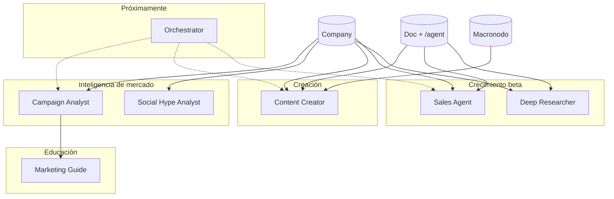

# Catálogo de agentes — Futura Nota

Referencia visual de **qué hace cada agente**, cómo se cablea en canvas, qué escribe y quién puede usarlo.

> Última actualización según `src/lib/agents/registry.js` y prompts en `content/agents/`.

---

## Resumen por categoría

| Categoría | Agentes | Para qué sirve |
|-----------|---------|----------------|
| **Inteligencia de mercado** | Campaign Analyst, Social Hype Analyst | Señales de marca, campañas, distribución social |
| **Educación & playbook** | Marketing Guide | Cómo usar las herramientas Intel de Futura Nota |
| **Creación de contenido** | Content Creator | Planes, hooks, blogs y copy desde `/agent` |
| **Ventas & funnel** | Sales Agent *(beta)* | Plan de ventas, funnel y adviser de metas |
| **Investigación profunda** | Deep Researcher *(beta)* | Mapa de estudio sin decidir por el usuario |
| **Orquestación** *(próximamente)* | Orchestrator | Delegar a otros agentes desde un solo nodo |

---

## Leyenda rápida

| Símbolo | Significado |
|---------|-------------|
| **Público** | Visible y ejecutable para cualquier cuenta con créditos |
| **Beta** | Solo cuentas en allowlist (`contact.fnota@gmail.com` por defecto) |
| **Próximamente** | En registry pero `enabled: false` |
| **3 cr** | Cuesta 3 créditos Intel por ejecución |
| **Gratis** | 0 créditos |

---

## 1. Inteligencia de mercado

### Campaign Analyst

| | |
|---|---|
| **ID** | `campaign-analyst` |
| **Estado** | Público · activo |
| **Costo** | 3 créditos / run |
| **Prompt** | `content/agents/campaign-analyst.{en,es}.md` |

**Qué hace**

- Analiza **lanzamientos, campañas y movimientos estratégicos** de una marca.
- Busca señales en fuentes oficiales, prensa, rumores y campañas recientes.
- Horizonte: ~90 días atrás + ventana hacia adelante (qué viene).
- Escribe un **informe estratégico** en el documento de campaña/content conectado.

**No hace**

- Tutoriales de producto (eso es Marketing Guide).
- Distribución por red social (eso es Social Hype).
- Crear contenido o todos de blog (eso es Content Creator).

**Cableado en canvas**

```
[Objeto Company] ──► [Campaign Analyst] ──► [Documento campaña / content]
```

**Entradas**

- Marca desde objeto Company cableado o corpus seleccionado.
- Documento de salida (campaña o content doc).

**Salida en documento**

- Informe analítico (`reportPresentation`: analyst-strategic-v2).
- Hechos, señales futuras, lectura estratégica.

---

### Social Hype Analyst

| | |
|---|---|
| **ID** | `social-hype-analyst` |
| **Estado** | Público · activo |
| **Costo** | 3 créditos / run |
| **Prompt** | `content/agents/social-hype-analyst.{en,es}.md` |

**Qué hace**

- Mapea **dónde publica la marca** y **dónde concentra atención** (TikTok, YouTube, X, prensa, etc.).
- Tono educativo y reflexivo: *"mi lectura es…"*, sin imponer un canal.
- Enriquece cada red con formato, tipo de conversación y comportamiento de audiencia.

**No hace**

- Calendario, Forecast, tutoriales YouTube (Marketing Guide).
- Fechas de lanzamiento o hechos de producto (Campaign Analyst).

**Cableado en canvas**

```
[Objeto Company] ──► [Social Hype Analyst] ──► [Documento opcional]
```

**Salida en documento**

- Saludo + intro, resumen de distribución, insights por canal, lectura principal, matices del mix, temas.
- `reportPresentation`: social-hype-v1.

---

## 2. Educación & playbook

### Marketing Guide

| | |
|---|---|
| **ID** | `marketing-guide` |
| **Estado** | Público · activo |
| **Costo** | **Gratis** (0 créditos) |
| **Prompt** | `content/agents/marketing-guide.{en,es}.md` |
| **En UI** | Botón **Guide** en toolbar del pack (no aparece en lista de agentes del panel) |

**Qué hace**

- Enseña **cómo usar Futura Nota Intel** paso a paso.
- Conecta la señal de la marca (informe del Analyst si existe) con herramientas:
  - Calendar
  - Forecast
  - Market Hype & Active Campaigns
  - Search
  - YouTube
- Escribe un **Playbook** en el documento.

**Regla clave**

- **No necesita saber qué producto vendés.** Enseña dónde mirar, cuándo y por qué.
- Siempre escribe las 5 secciones de herramientas aunque no haya datos del Analyst.

**Cableado en canvas**

```
[Objeto Company] ──► [Marketing Guide] ──► [Documento]
     (opcional: informe del Campaign Analyst como contexto)
```

**Salida**

- `reportPresentation`: marketing-guide-v1.

---

## 3. Creación de contenido

### Content Creator

| | |
|---|---|
| **ID** | `content-creator` |
| **Estado** | Público · activo |
| **Costo** | 3 créditos / run |
| **UX mínima** | ~18 s de estado "Running" |
| **Prompt** | `content/agents/content-creator.{en,es}.md` |

**Qué hace**

- Lee **solo** la celda `/agent` (instrucción del usuario).
- Usa **Company + Knowledge** para tono y contexto de marca.
- Dos modos según el cableado:

#### Modo A — `document_plan` (plan en documento)

**Cuándo:** documento content con `/agent` cableado al agente (sin macro como fuente principal).

**Entrega en el documento:**

- H1 + texto del entregable (hooks, borrador, etc.).
- Todo con ítems accionables.
- Recomendación de canal (si el prompt era vago).
- Mensaje de siguientes pasos (macronodo + schedule).

**Ejemplo de instrucción**

> *Creame 5 hook titles para un blog dirigido a audiencia joven que quiere emprender*

#### Modo B — `macro_blog` (blog en macronodo)

**Cuándo:** macronodo cableado con título + `/agent` + (opcional) schedule.

**Entrega:**

- Blog completo **dentro del macronodo** (H1 + párrafos).
- Preserva `/agent`, todo y link vault previos.
- Abre el macro al terminar.

**Gate de schedule**

- Si el macro tiene `anchorAt` en el **futuro**, Run manual queda bloqueado hasta esa fecha/hora.

**Cableado — plan en documento**

```
[Company] ──► [Content Creator] ──► [Doc content con /agent]
```

**Cableado — blog en macro**

```
[Company] ──► [Content Creator] ──► [Macronodo con /agent + schedule]
```

---

## 4. Ventas & funnel *(beta)*

### Sales Agent

| | |
|---|---|
| **ID** | `sales-agent` |
| **Estado** | **Beta** · solo `contact.fnota@gmail.com` |
| **Costo** | 3 créditos / run |
| **UX mínima** | ~18 s |
| **Prompt** | `content/agents/sales-agent.{en,es}.md` |

**Qué hace**

- Diseña un **plan de ventas** y te guía por el **funnel** paso a paso.
- Combina secuencia comercial (awareness → cierre) con **adviser de metas**:
  - Métrica norte
  - Hitos semanales
  - Señales rojas
  - Preguntas de descubrimiento
- **No cierra por vos:** mapea acciones y métricas; no impone precio ni oferta final.

**Entrega en documento**

| Bloque | Contenido |
|--------|-----------|
| H1 + texto | Narrativa del funnel completo |
| Todo | Etapas con acciones + qué medir |
| Texto | Estrategia de meta (`goalStrategy`) |
| Texto | Siguientes pasos (elegir etapa → macronodo) |

**Cableado**

```
[Company] ──► [Sales Agent] ──► [Doc content con /agent]
```

**Ejemplo de instrucción**

> *Ayudame a crear un plan de venta para mi programa de coaching keto para principiantes*

---

## 5. Investigación profunda *(beta)*

### Deep Researcher

| | |
|---|---|
| **ID** | `deep-researcher` |
| **Estado** | **Beta** · solo `contact.fnota@gmail.com` |
| **Costo** | 3 créditos / run |
| **UX mínima** | ~18 s |
| **Prompt** | `content/agents/deep-researcher.{en,es}.md` |

**Qué hace**

- Desglosa **ciencia, mecanismos y problemas de raíz** que debés estudiar.
- Entrega un **mapa paso a paso** — no decide por el usuario.
- Cada fase del todo incluye conceptos + preguntas que **vos** debés responder.

**Reglas duras del agente**

- Usa: *"Estudiá…"*, *"Investigá si…"*, *"Validá…"*
- Prohibido: *"Deberías…"*, *"Tu producto debe…"*, *"La mejor estrategia es…"*
- Sin estudios, papers o estadísticas inventadas.

**Entrega en documento**

| Bloque | Contenido |
|--------|-----------|
| H1 + texto | Panorama del camino de aprendizaje |
| Todo | Fases de estudio |
| Texto | Alcance (`studyScope`) |
| Texto | Preguntas abiertas |
| Texto | Siguientes pasos |

**Ejemplo de instrucción**

> *Necesito entender cómo funciona la cetosis para crear un producto en Keto Loop*

**Cableado**

```
[Company] ──► [Deep Researcher] ──► [Doc content con /agent]
```

---

## 6. Orquestación *(próximamente)*

### Orchestrator

| | |
|---|---|
| **ID** | `orchestrator` |
| **Estado** | **Próximamente** (`enabled: false`) |
| **Costo** | 3 créditos / run (cuando esté activo) |
| **Prompt** | `content/agents/orquestador-sistema.{en,es}.md` |

**Qué hará (diseño)**

- Punto de entrada único en canvas.
- Lee instrucciones de macronodos conectados (`/agent`).
- Delega al agente especialista correcto según la tarea.

**Hoy**

- No aparece como ejecutable en canvas.
- Los agentes se corren **directamente** desde su nodo en canvas.

---

## Protocolo común: celda `/agent`

Varios agentes leen la instrucción desde un bloque **`/agent`** en documentos o macronodos.

```
/todo   → plan del usuario (opcional)
/agent  → instrucción que lee el agente  ← ESTO ES LO QUE IMPORTA
…       → contenido generado / continuación
```

| Agente | Lee `/agent` de |
|--------|-----------------|
| Content Creator | Documento **o** macronodo (según modo) |
| Sales Agent | Documento content |
| Deep Researcher | Documento content |
| Orchestrator *(futuro)* | Macronodos cableados |

---

## Contexto que comparten los agentes

| Fuente | Qué aporta |
|--------|------------|
| **Objeto Company** | Marca, nombre, descripción |
| **Knowledge docs** | Tono, voz, memoria de marca, guías SEO |
| **Documento content** | Instrucción `/agent` + destino del output |
| **Macronodo** | Título, schedule, instrucción `/agent` (Content Creator macro) |
| **Informe Analyst** | Contexto para Marketing Guide (opcional) |

---

## Costos de créditos

| Agente | Créditos / run |
|--------|----------------|
| Campaign Analyst | 3 |
| Social Hype Analyst | 3 |
| Content Creator | 3 |
| Sales Agent | 3 |
| Deep Researcher | 3 |
| Marketing Guide | **0** |
| Orchestrator | 3 *(cuando esté activo)* |

---

## Acceso por cuenta

| Agente | Acceso |
|--------|--------|
| Campaign Analyst | Todos |
| Social Hype Analyst | Todos |
| Marketing Guide | Todos |
| Content Creator | Todos |
| Sales Agent | **Beta** — `contact.fnota@gmail.com` |
| Deep Researcher | **Beta** — `contact.fnota@gmail.com` |
| Orchestrator | Deshabilitado globalmente |

Para ampliar beta: editar `allowedEmails` en `registry.js` o variable `AGENT_BETA_ALLOWLIST` en servidor.

---

## Dónde insertar cada agente en la UI

| Agente | Panel izquierdo (Agents) | Botón Guide | Canvas drag |
|--------|--------------------------|-------------|-------------|
| Campaign Analyst | Sí | — | Sí |
| Social Hype Analyst | Sí | — | Sí |
| Content Creator | Sí | — | Sí |
| Sales Agent | Sí *(si beta)* | — | Sí |
| Deep Researcher | Sí *(si beta)* | — | Sí |
| Marketing Guide | **No** | **Sí** (toolbar pack) | Sí (vía Guide) |
| Orchestrator | No (deshabilitado) | — | — |

---

## Flujo recomendado por objetivo

### "Quiero inteligencia de mi competidor/marca"

```
Campaign Analyst → (opcional) Marketing Guide → acción en Calendar / Hype
```

### "Quiero saber en qué redes está la atención"

```
Social Hype Analyst
```

### "Quiero ideas de contenido o escribir un blog"

```
Content Creator (document_plan) → elegir todo → macro + schedule → Content Creator (macro_blog)
```

### "Quiero un plan de ventas"

```
Sales Agent + /agent en doc content
```

### "Quiero estudiar un tema antes de decidir producto"

```
Deep Researcher + /agent en doc content
```

---

## Diagrama de categorías



---

## Archivos de referencia en el repo

| Tema | Ruta |
|------|------|
| Registry y flags | `src/lib/agents/registry.js` |
| Acceso beta | `src/lib/agents/agentAccess.js` |
| Costos | `src/lib/agents/agentCreditCosts.js` |
| Ejecutar desde canvas | `src/lib/agents/executeAgentRun.js` |
| Gate de schedule (Content Creator) | `src/lib/agents/agentScheduleGate.js` |
| Prompts de sistema | `content/agents/*.md` |
| i18n (nombres UI) | `src/i18n/messages.js` → `agents.*` |

---

*Documento generado para uso interno y onboarding. Si agregás un agente nuevo, actualizá `registry.js` y esta tabla.*
